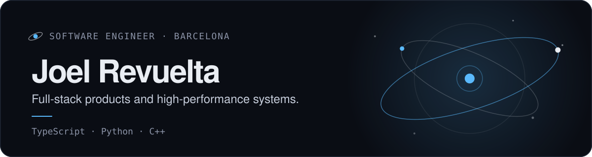

  

Software engineer in Barcelona. I build full-stack products and high-performance systems in TypeScript, Python and C++.

I'm completing a Master's in Software Development and Information Technologies at EPITECH and Koç University. I worked at NTT Data as a software developer intern on a blood and tissue bank management system.

  
  
  
  

## Selected work

### [RayTracer](https://github.com/Joel-Revuelta/ray-tracer)

C++20 path tracer with CPU and CUDA renderers, a runtime plugin architecture and 34 scenes rendered up to 8K.

### [FAS](https://fas-ai.net)

AI contract generation for freelancers and small agencies in Spain. Turns video call transcripts into reviewable contract drafts. Go, PostgreSQL, Next.js and AI.

**More work**

- [AREA](https://github.com/Joel-Revuelta/area) — IFTTT-style automation platform built with FastAPI, PostgreSQL, Next.js and React Native.
- [Syscall Sandbox](https://github.com/Joel-Revuelta/syscall-sandbox) — Linux syscall sandbox using eBPF, a kernel module and ptrace.
- [Torch](https://github.com/Joel-Revuelta/Torch) — neural-network chessboard analyzer working from FEN positions.
- [City Matcher](https://joel-revuelta.github.io/CityMatcher) — Angular app that uses AI to match people with cities; winner of the 2024 Extia Hackathon.

## Stack

  <picture>
    <source media="(prefers-color-scheme: dark)" srcset="https://skillicons.dev/icons?i=c%2Ccpp%2Cpy%2Cts%2Cgo%2Cjava%2Cangular%2Cnextjs%2Cnestjs%2Cfastapi%2Cspring%2Cdocker%2Cgit%2Clinux%2Cpostgres&amp;theme=dark&amp;perline=8" />
    
  </picture>

## Background

EPITECH & Koç University · NTT Data · Extia Hackathon winner 2024 · Barcelona, Spain
